 
**Links:** [W&B Report (`ucu-visdrone-hw2`)](https://forge.coreweave.com/wandb/veresniuk-pn-ukrainian-catholic-university/ucu-visdrone-hw2/reports/HW2--VmlldzoxODMxODAxMw?accessToken=ib415vmgzysayt72n0odylvpdp1mzr17r3ntqrc5qbfgq8zws6ad4j560m4yku4m) | [GitHub Repository](https://github.com/Zaharkos/CV_Homework)
 
## 1. Methodology and Motivation
 
### Looking at the data first
 
VisDrone is big: about 1.2M boxes, 27k frames and 8 classes. Before training I looked at the data first, and a few things were clear right away.
 
|split|clips|frames|small (<32x32)|medium|large (>96x96)|mean obj/frame (max)|
|---|---|---|---|---|---|---|
|train|56|24,201|24.9%|63.5%|11.6%|45.7 (180)|
|val|7|2,846|19.2%|69.5%|11.3%|40.1 (116)|
|test|48|3,811|-|-|-|-|
 
**Classes are imbalanced.** `car` and `person` are about 75% of all boxes, `bus` is less than 1%. So rare classes will be bad.
 
**Tiny objectss.** The median box is ~30 px, and default anchors start at 32 px. I made anchors 2 times smaller, and anchor coverage went from ~72% to ~98%.
 
**Scenes are crowded.** 40+ objects per frame on average, up to 180. So I allowed up to 300–500 detections per image.
 
**Ignoring regioens.** On train I painted them grey. On val I marked them as `iscrowd`, so detections there are not counted as errors.
 
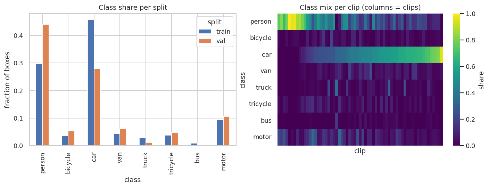
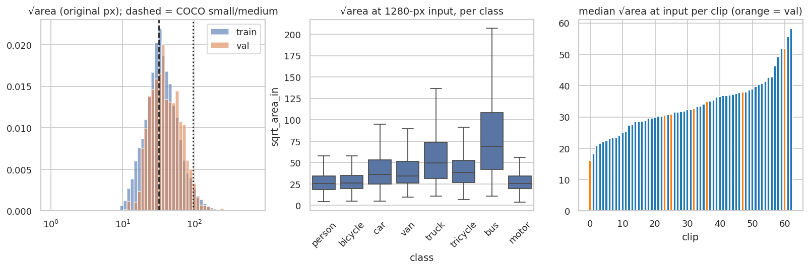
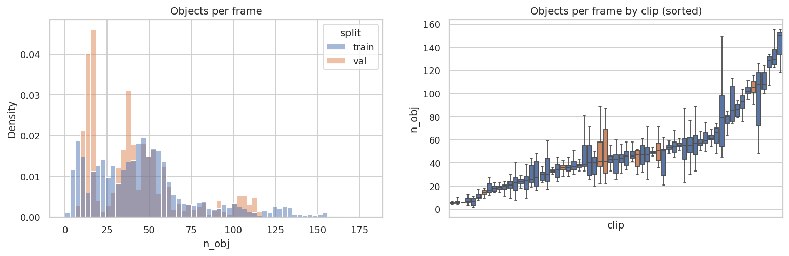
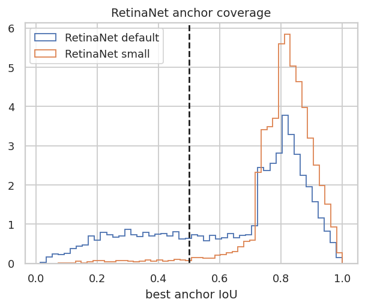
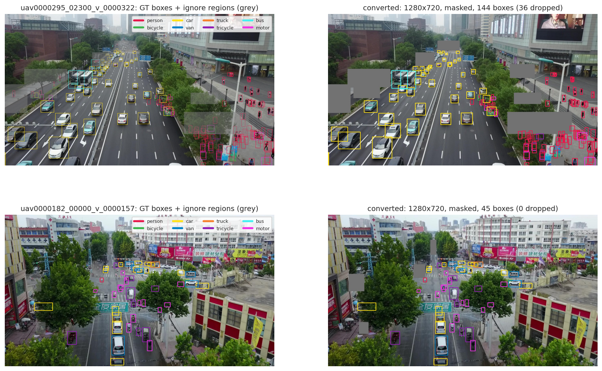
 
### How I validated
 
**Split by video** Neighbour frames look almost the same, so I used the official 7 val clips.
 
**Skippied frames** For experiments I took every 9th frame, for final models every 3rd.
 
**Same rules for all** 1280 px input, seed 0, 45 min on a T4, evaluation with `pycocotools`.
 
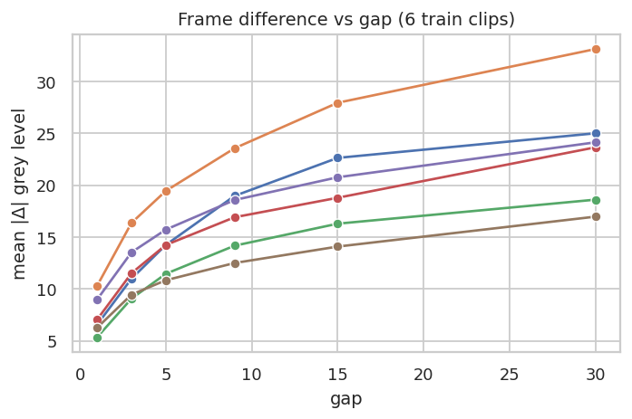
 
## 2. Results and Analysis
 
### 2.1 Faster R-CNN
 
I started with Faster R-CNN (ResNet-50-FPN, COCO weights). I tried 4 versions: baseline, smaller anchors, more positive RoIs and GIoU loss.
 
|run|mAP|AP50|AP_small|AP_medium|AP_large|ms/img|
|---|---|---|---|---|---|---|
|E0 baseline|0.2035|0.4174|0.0904|0.1783|0.3988|72.5|
|E1 small anchors|0.2055|0.4304|0.1003|0.1829|0.3801|74.4|
|E2 + RoI 50% pos|0.2015|0.4198|0.1006|0.1813|0.3822|72.4|
|E3 + GIoU|0.2071|0.4400|0.1027|0.1844|0.3858|73.8|
 
Small anchors helped small objects, GIoU helped a bit more. `E3` was the best with 0.207 mAP. The differences are small though.
 
**Where it fails.** The first stage (RPN) finds most objects. The second stage is the problem, it throws many of them away. I saw three main mistakes:
 
**Night + crowds.** In dark scenes with many people, a lot of them are missed.
 
**Similar classes.** From above, `van` and `car` look the same. Same for `motor`, `bicycle` and `person`.
 
**Missing labels.** Many "false positives" are real objects that are just not labeled.
 
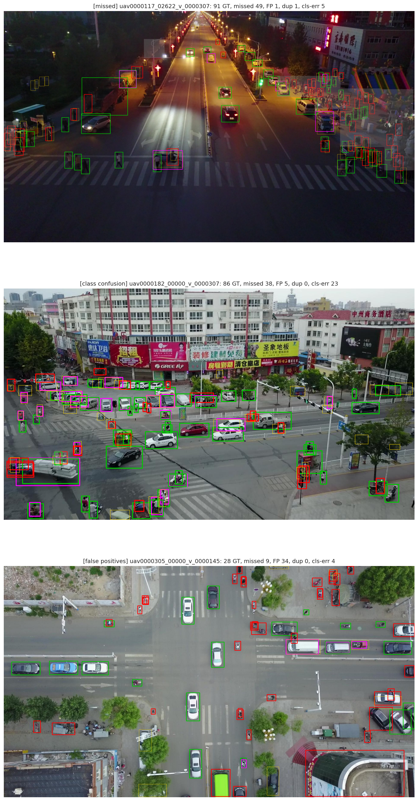
 
### 2.2 RetinaNet
 
Then I tried RetinaNet with the same setup.
 
|run|mAP|AP50|AP_small|AP_medium|AP_large|ms/img|
|---|---|---|---|---|---|---|
|E0 baseline|0.1391|0.2684|0.0504|0.1136|0.3020|69.3|
|E1 small anchors|0.1238|0.2789|0.0587|0.1046|0.2573|68.5|
|E2 + IoU 0.4/0.3|0.1085|0.2420|0.0553|0.0935|0.2325|70.6|
|E3 + GIoU|0.1212|0.2735|0.0606|0.1054|0.2582|68.7|
 
It was worse. RetinaNet has no first stage, so it must check all ~176k anchors. Most of them are background. Small anchors made this worse, and mAP went down. It also made 2 times more class errors than Faster R-CNN.
 
### 2.3 YOLO11-s
 
Next I trained YOLO11-s at 1280 px. I tried an extra P2 head and NWD loss, both should help small objects.
 
|run|mAP|AP50|AP_small|AP_medium|AP_large|ms/img|epochs|
|---|---|---|---|---|---|---|---|
|E0 baseline|0.2131|0.4182|0.1188|0.2020|0.3447|17.0|16|
|E1 P2 head|0.2109|0.4159|0.1239|0.1840|0.3582|25.8|10|
|E2 NWD loss|0.2122|0.4110|0.1318|0.1983|0.3684|19.6|16|
|E3 P2 + NWD|0.2139|0.4363|0.1260|0.1880|0.3752|23.9|10|
 
YOLO has no anchors. It picks positive points using both class score and box overlap, which works better for small objects. Even the baselinr beat Faster R-CNN and was ~4x faster.
 
P2 and NWD almost didn't change mAP, and P2 was slower. I kept the simple version. 1280 px was the best inference size.
 
### 2.4 RT-DETR-L
 
Last I tried a transformer, RT-DETR-L.
 
|run|mAP|AP50|AP_small|AP_medium|AP_large|ms/img|
|---|---|---|---|---|---|---|
|E0 300 queries|0.1052|0.1959|0.0540|0.0908|0.2151|90.4|
|E1 500 queries|0.0503|0.1017|0.0192|0.0476|0.1154|88.2|
|E2 frozen backbone|0.0000|0.0000|0.0000|0.0000|0.0000|89.6|
|E3 lr x3|0.0000|0.0002|0.0000|0.0001|0.0005|81.4|
 
It did not converge in 5 epochs. This model needs long training. The best run got about half of YOLO. More queries made it worse, and two runs fell to zero. It found many objects, but gave a lot of duplicate boxes, so mAP was low.
 
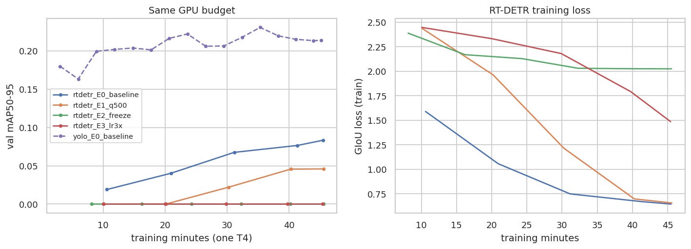
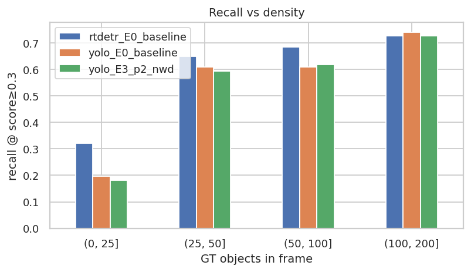
 
### 2.5 Final pipeline
 
YOLO was the best and the fastest. I trained two models on 3 times more data for 3 hours: `final_A` (`yolo11s`) and `final_B` (`yolo11m`).
 
It didn't help. Both got around 0.21 mAP, same as before. `yolo11m` was better on small objects, but it had time for only 12 epochs.
 
So I tried different inference tricks:
 
|strategy|mAP|AP50|AP_small|AP_medium|
|---|---|---|---|---|
|S0 full frame 1280 (`final_A`)|0.2113|0.4040|0.1202|0.1848|
|S1 full frame 1536|0.2140|0.4135|0.1325|0.1964|
|S2 full frame 1920|0.2078|0.4054|0.1463|0.2051|
|S3 1280 + 2x2 tiles, NMS (SAHI-style)|0.2231|0.4279|0.1238|0.2109|
|S4 1280 + 2x2 tiles, WBF|0.2237|0.4382|0.1299|0.2095|
|S5 TTA flip + scale, 1280|0.2275|0.4335|0.1199|0.1939|
|S6 WBF ensemble `final_A` + `final_B` (each S5)|**0.2348**|**0.4548**|**0.1406**|**0.2203**|
 
It worked. TTA gave +1.6 mAP points, and combining the two models gave +0.7 more. The two models are good at different sizes, so together they work better.
 
Main submission: `S6` (`submission_final.csv`, 0.2348 val mAP, LB: `0.2245912863
`).
 
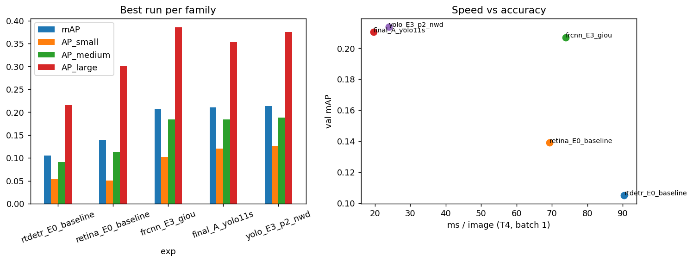
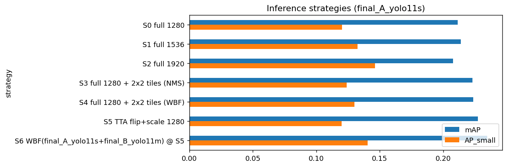
 
### 2.6 Bonus: looking inside the models
 
All logs and plots are in W&B (`ucu-visdrone-hw2`).
 
**Grad-CAM.** Shows which feeture level Faster R-CNN uses: small boxes use the high-resolution level, big boxes use lower.
 
**UMAP.** I put Faster R-CNN box features on a 2D plot. `van` and `car` are mixed together, same as in the errors.
 
**RT-DETR attention.** From layer to layer, the model looks closer to the object center.
 
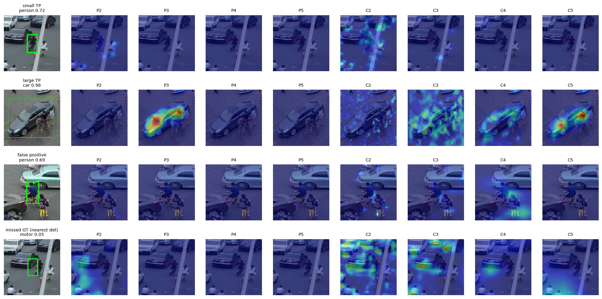
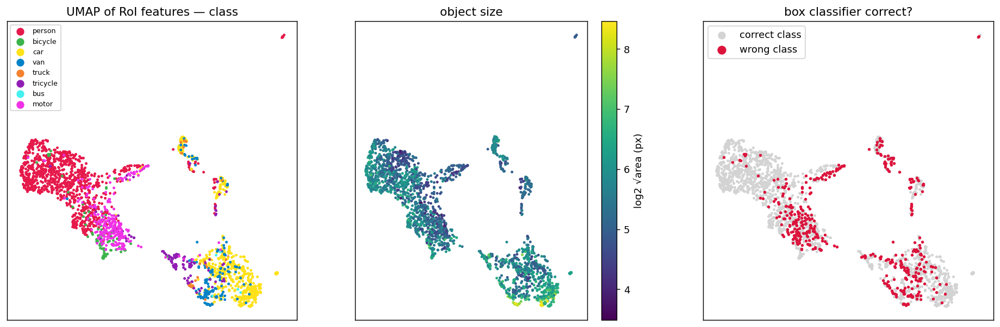
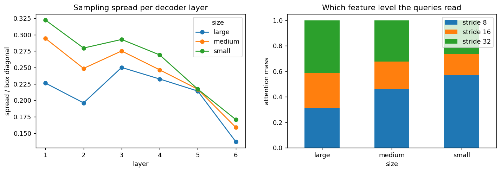
 
## 3. Final Model and How to Run
 
**Final model (`S6`):** `yolo11s` + `yolo11m` combined with WBF, with flip and scale TTA.
 
**Environment:** Kaggle, **GPU T4 x2**, **Internet ON**, `WANDB_API_KEY` secret.
 
**Steps:**
1. Open `code/notebooks/1_data_and_detectors.ipynb`, set `REPO_URL` and `DEBUG = False`, attach VisDrone and run all (~7.5 h). It does EDA and trains all 16 test runs.
2. Open `code/notebooks/2_final_viz_summary.ipynb` (`DEBUG = False`), attach the dataset and notebook 1 outputs, run all (~5 h). It trains the final models and saves `submissions/submission_final.csv`.

**Dependencies:** code/requirements.txt Seed 0 everywhere.

## References
 
**Code and libraries:** torchvision detection models; Ultralytics YOLO11 and RT-DETR (AGPL-3.0); pycocotools; ensemble-boxes (WBF); umap-learn; Weights & Biases.
